# Simulation and Optimization of Inventory Management

**AMS 553 / CSE 529 Final Project.** Jahnavi Gouru · Mary Reethika Reddy Kolukula · Praneeth Kapila

We simulate a single-product inventory system that is reviewed once a month, with random demand and random delivery lags (the inventory example of Law & Kelton). We use the simulation to choose between two reorder policies:

* **(s, S):** if the inventory level drops to *s* or below, order enough to bring it back up to *S*;
* **(s, Q):** if the inventory level drops to *s* or below, order a fixed quantity *Q*.

📄 **[Report (PDF)](report/report.pdf)** · [Report (Markdown)](report/report.md) · 📊 **[Slides (PPTX)](presentation/inventory_simulation_slides.pptx)** · [Slides (PDF)](presentation/inventory_simulation_slides.pdf)

## Result

| | Best rule | Average monthly cost (95% CI) |
|---|---|---|
| **(s, S)** | **s = 24, S = 62** | **$118.13 ± 0.07** |
| (s, Q) | s = 24, Q = 51 | $119.05 ± 0.07 |
| Law & Kelton starting rule | (s, S) = (20, 40) | $124.84 ± 0.08 |

**Recommendation: use (s, S) = (24, 62).**

* It is **$0.92/month cheaper** than the best (s, Q) rule: 95% CI [$0.90, $0.95], paired-t on 10,000 common-random-number replications, t = 62.3.
* It is **5.4% cheaper** than the textbook's (20, 40) rule.
* It wins in **all 14** sensitivity scenarios.
* It is robust: any S from 54 to 71 stays within $1 of the optimum.

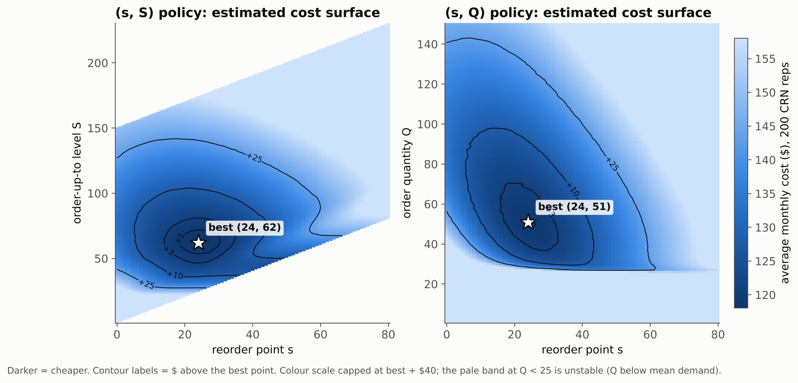

## How we know it's right

* **Verification:** two independent implementations of the event logic (a compiled kernel and a pure-Python reference) give identical results; 15 unit tests.
* **Validation against the textbook:** we reproduce the nine Law & Kelton (s, S) policies. The exact value lies inside the 95% CI for all nine.
* **Validation against exact theory:** delivery lags are at most one month, so the inventory at each review is a Markov chain, and the exact expected cost of any policy can be computed (`src/invsim/analytic.py`). Over all 24,300 grid points the simulation agrees with it, r > 0.99999.
* **Search audit:** our simulation-based search picked the true optimum for (s, Q) and came within $0.002/month of it for (s, S).

## Method

1. **Screen** every integer (s, S) and (s, Q) with s ∈ [0, 80] and S − s, Q ∈ [1, 150]: 12,150 points per policy × 200 CRN replications.
2. **Re-evaluate** the top 20 of each policy with 5,000 *fresh* replications, which removes the optimizer's-curse bias. Compare each candidate with the best by Bonferroni paired-t tests.
3. **Compare** the two winners with 10,000 new CRN replications. CRN cuts the variance of the difference to 9.7% of what independent sampling gives, about 10× fewer replications for the same precision.
4. **Sensitivity:** re-optimize both policies under 14 settings of the setup, holding and shortage costs.

## Repository layout

```
src/invsim/
  model.py        discrete-event simulation, CRN random-number streams      (Jahnavi Gouru)
  experiment.py   replications, confidence intervals, paired-t, CRN         (Mary Reethika Reddy Kolukula)
  optimize.py     grid screening, re-evaluation, selection of the best      (Praneeth Kapila)
  analytic.py     exact Markov-chain cost, used only for validation
experiments/
  run_all.py      runs every experiment -> results/tables, results/data, results/summary.json
  make_figures.py all figures -> results/figures
  key_numbers.py  headline numbers -> results/key_numbers.json (read by the slides)
tests/            15 pytest tests
results/          tables (CSV), raw data, figures, run log
report/           report.md, report.pdf
presentation/     build_deck.js -> inventory_simulation_slides.pptx (+ PDF)
```

## Reproduce

```bash
pip install -r requirements.txt
python -m pytest -q
python experiments/run_all.py          # about 4 minutes (--quick: 5-second smoke test into results_quick/)
python experiments/make_figures.py
python experiments/key_numbers.py
cd presentation && npm install && node build_deck.js
```

All random numbers come from fixed seeds, so every number in the report and slides is reproducible.

## Figures

| | |
|---|---|
| 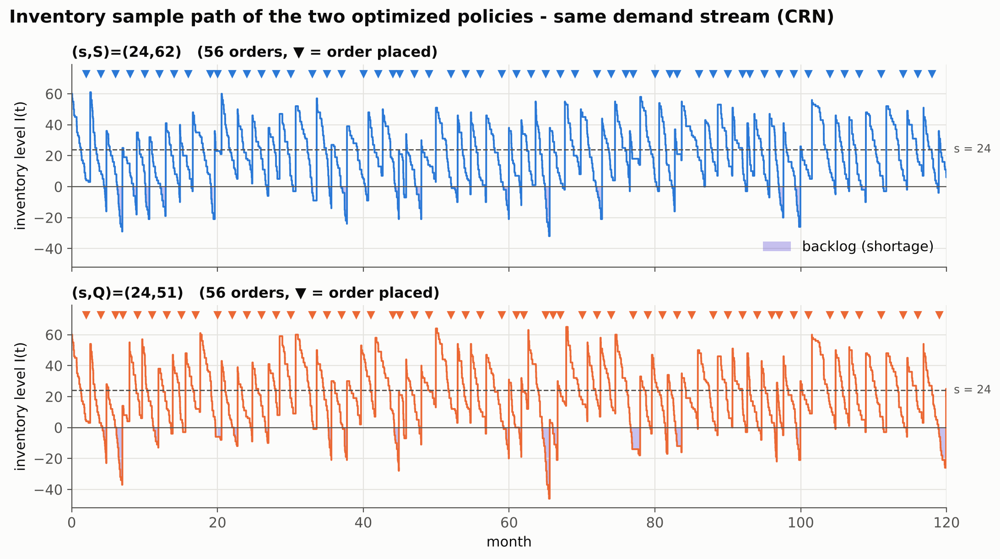 | 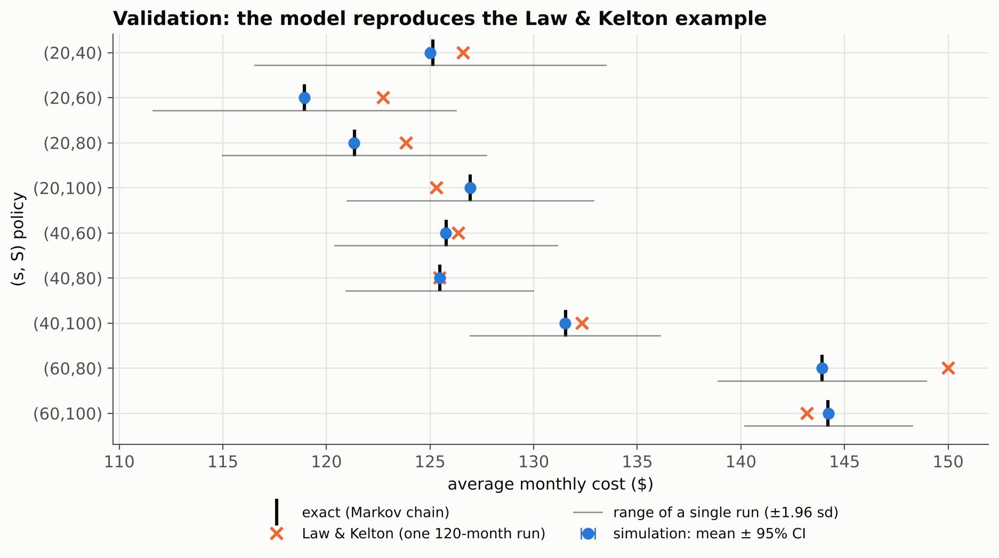 |
| 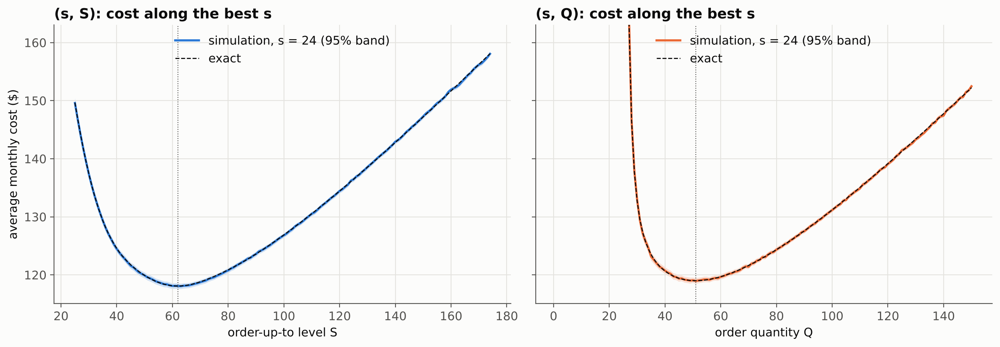 | 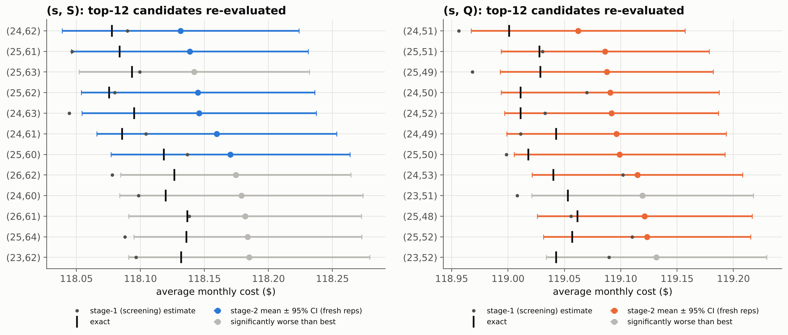 |
| 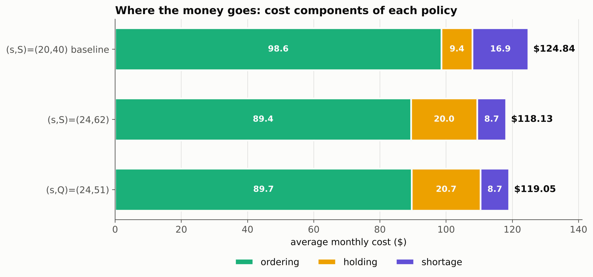 | 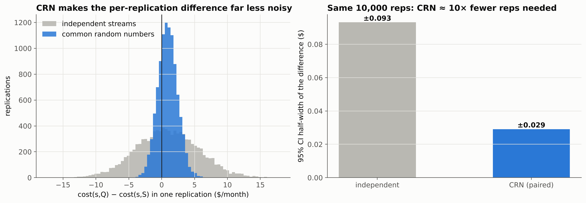 |
| 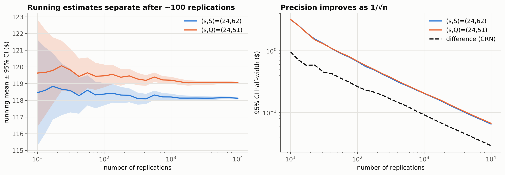 | 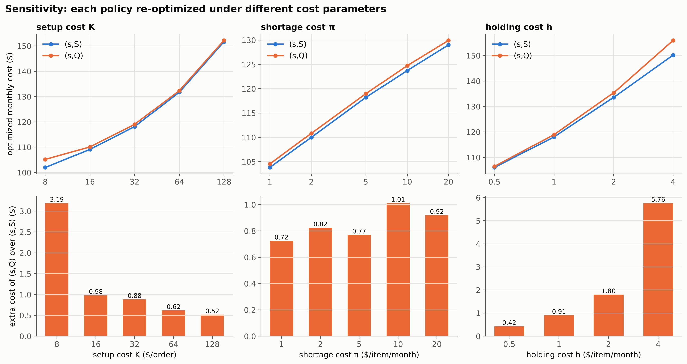 |
| 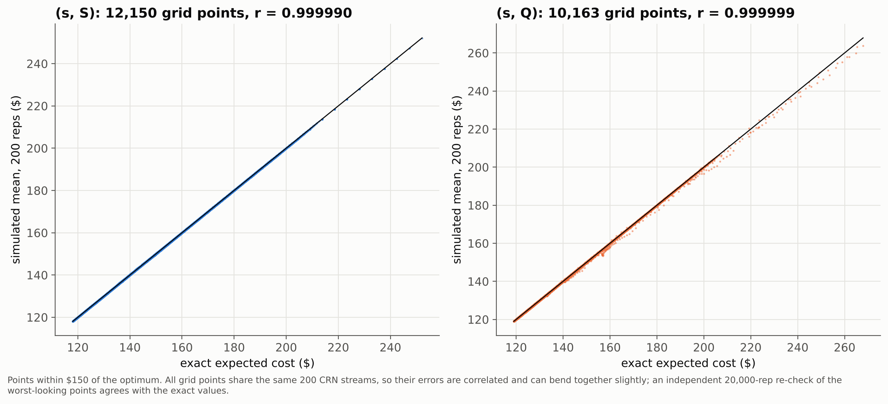 | 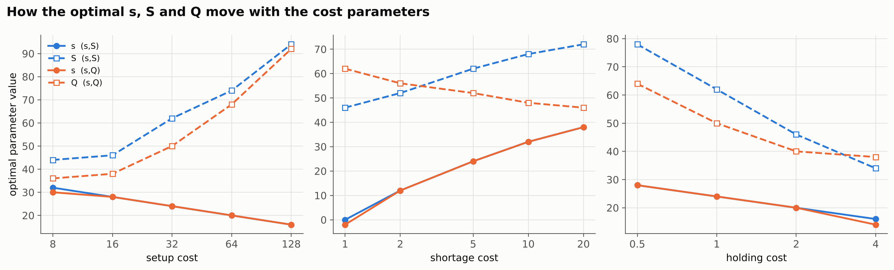 |

## References

* A. M. Law, *Simulation Modeling and Analysis*, 5th ed., McGraw-Hill, 2015, §1.5.
* H. Scarf, "The optimality of (S, s) policies in the dynamic inventory problem," 1960.
* B. L. Nelson, *Foundations and Methods of Stochastic Simulation*, 2nd ed., Springer, 2021.
