## Summary

We simulated a single-product inventory system that is reviewed once a month, with random demand and random delivery lags. The model follows the inventory example of Law & Kelton. We compared two reorder policies on it: **(s, S)**, which orders up to a level S, and **(s, Q)**, which orders a fixed quantity Q. For each policy we searched every integer parameter combination in a wide range: 12,150 points per policy, 24,300 rules in total. The search used common random numbers (CRN), and the costs of the best candidates were then re-estimated with fresh, independent replications.

| | Best rule | Average monthly cost (95% CI) |
|---|---|---|
| **(s, S)** | s = 24, S = 62 | **$118.13 ± 0.07** |
| (s, Q) | s = 24, Q = 51 | $119.05 ± 0.07 |
| Law & Kelton starting rule | (s, S) = (20, 40) | $124.84 ± 0.08 |

**Recommendation: use the (s, S) policy with s = 24 and S = 62.** It costs **$0.92 per month less** than the best (s, Q) rule. The 95% CI on the difference is [$0.90, $0.95] (paired-t, 10,000 CRN replications, t = 62.3). It is also **$6.71 per month (5.4%) cheaper** than the textbook's (20, 40) rule. The advantage is small but certain. It holds in all 14 cost scenarios of our sensitivity analysis, and it grows to $5.76 per month when storage is expensive.

The simulation was checked two ways. First, it reproduces the textbook example. Second, it matches an exact Markov-chain calculation of the expected cost, which the structure of this system makes possible. That exact calculation also shows our simulation-based search found the true optimum for (s, Q), and came within $0.002 of it for (s, S).

## 1. Problem

The company reviews its stock at the start of each month and decides whether to order and how much. Ordering often pays the fixed setup charge many times. Holding a lot of stock costs storage. Holding too little leaves customers waiting. Demand and delivery times are both random, so the balance between these costs has no simple closed form. Simulation lets us estimate a rule's **average monthly cost** before the company commits to it.

## 2. Model

The system is the inventory example of Law & Kelton (Section 1.5).

| Element | Specification |
|---|---|
| Review | start of every month, t = 0, 1, …, 119; the run lasts 120 months |
| Initial inventory | I(0) = 60 |
| Demand | Poisson arrivals, mean inter-demand time 0.1 month (10 per month); size D ∈ {1, 2, 3, 4} with probabilities 1/6, 1/3, 1/3, 1/6 (mean 2.5, so 25 items/month) |
| Unmet demand | backlogged: the inventory level I(t) may go negative |
| Delivery lag | Uniform(0.5, 1) month |
| Ordering cost | K + i·Z for an order of Z items, with K = $32 and i = $3 |
| Holding cost | h = $1 per item per month, charged on I⁺(t) = max(I(t), 0) |
| Shortage cost | π = $5 per item per month, charged on I⁻(t) = max(−I(t), 0) |

The average monthly cost of one replication is

  C = [Σ orders (K + i·Z) + h ∫₀¹²⁰ I⁺(t) dt + π ∫₀¹²⁰ I⁻(t) dt] / 120.

**Policies.** At each review with inventory level I:

* **(s, S):** if I ≤ s, order S − I. The level after delivery is always S minus whatever demand arrived in the meantime.
* **(s, Q):** if I ≤ s, order a fixed Q. Every shipment is the same size, but the level after delivery depends on how low the stock had fallen.

We used the proposal's trigger "s or below" (I ≤ s). The textbook orders when I < s, so for the validation in Section 4 we switched to the textbook rule. Note that I ≤ s is the same rule as I < s + 1.

## 3. Implementation (simulation model, Jahnavi Gouru)

The simulation is a next-event discrete-event model written in Python (`src/invsim/model.py`). The event types are demand, order arrival, monthly review and end of run. Between events the inventory level is constant, so the holding and shortage areas are accumulated exactly as rectangles. The event loop is compiled with Numba and runs a 120-month replication in about 3 µs, which made a full-grid search with thousands of replications feasible.

**Random-number streams and CRN.** Each replication k draws three *separate* streams from `numpy.random.SeedSequence((base_seed, k, stream))`:

1. inter-demand times,
2. demand sizes,
3. delivery lags, where the j-th order placed uses the j-th lag.

Two policies simulated with the same (base_seed, k) therefore face the identical demand sequence, and their j-th orders get the same lag. This is common random numbers. Different base seeds give statistically independent experiments.

**Verification.** A second, independent pure-Python event loop (`trajectory()`, which also records sample paths) reproduces the compiled kernel *exactly* on every test case: same costs and same number of orders. The test suite (`tests/test_model.py`, 15 tests) also checks:

* reproducibility of the streams,
* the demand rate (simulated 25.00 items/month against the theoretical 25),
* the bounds on the delivery lags,
* conservation of inventory flow,
* the equivalence of I ≤ s and I < s + 1,
* that CRN reduces variance,
* unbiasedness against the exact cost (Section 4.2), including an unstable policy.

## 4. Validation

### 4.1 Against Law & Kelton

We ran the nine (s, S) policies of the textbook example with its "I < s" rule, using 5,000 independent replications per policy. Each policy got its own seed set, so the nine confidence intervals are independent.

| s | S | Simulation mean ± 95% CI | Exact (Sec. 4.2) | Law & Kelton, one run |
|---|---|---|---|---|
| 20 | 40 | 125.02 ± 0.12 | 125.12 | 126.61 |
| 20 | 60 | 118.93 ± 0.10 | 118.94 | 122.74 |
| 20 | 80 | 121.34 ± 0.09 | 121.35 | 123.86 |
| 20 | 100 | 126.94 ± 0.08 | 126.94 | 125.32 |
| 40 | 60 | 125.76 ± 0.08 | 125.77 | 126.37 |
| 40 | 80 | 125.46 ± 0.06 | 125.47 | 125.46 |
| 40 | 100 | 131.52 ± 0.07 | 131.55 | 132.34 |
| 60 | 80 | 143.91 ± 0.07 | 143.91 | 150.02 |
| 60 | 100 | 144.23 ± 0.06 | 144.20 | 143.20 |

The exact value lies inside the simulation's 95% CI for **all 9 policies**. The largest deviation is 1.77 standard errors. The textbook figures come from a *single* 120-month run per policy. A single run has a standard deviation of $2.1 to $4.3 here, so the textbook values scatter around ours by a few dollars, as expected (Figure 2). This scatter is also why one run per policy is not enough to rank policies. *Note: the textbook column was transcribed from the textbook's table of nine runs; please check it against your edition, since the numbers differ slightly between editions.*

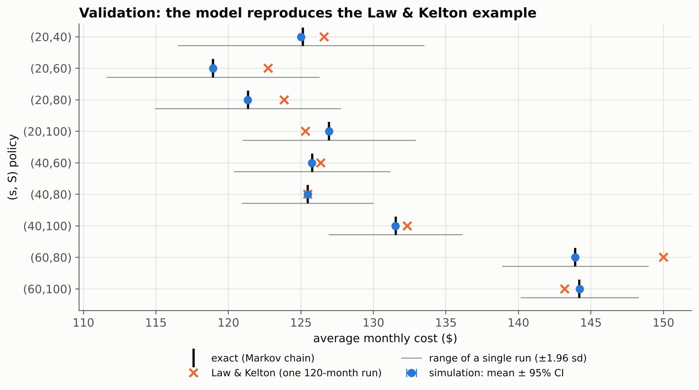

### 4.2 Against an exact Markov-chain calculation

The delivery lag is at most one month, so **every order arrives before the next review**. The inventory levels at the reviews, X(0) = 60, X(1), X(2), …, therefore form a Markov chain:

  X(k+1) = X(k) + z(X(k)) − D(k),

where z(x) is the policy's order quantity and D(k) is the compound-Poisson demand during month k. The expected cost during a month that starts at level x with order z is

  K·1{z>0} + i·z + ∫₀¹ E[c(x + z·1{L<t} − D(t))] dt,  with c(y) = h·y⁺ + π·y⁻ and L ~ U(0.5, 1).

We tabulated this integral with Gauss–Legendre quadrature, using the compound-Poisson distribution of D(t). We then propagated the exact distribution of X(k) forward for 120 months (`src/invsim/analytic.py`). This gives the exact expected average monthly cost over the same finite horizon that each simulation replication estimates. We used it **only to audit the simulation and the search, never to choose the policy.**

* For every one of the 24,300 grid points, the 200-replication simulation means agree with the exact costs. The correlation is r = 0.99999 for (s, S) and 0.999999 for (s, Q) (Figure 10).
* Two large tests with 200,000 replications each gave z = 0.14 and −1.28, so there is no detectable bias.
* Policies with Q below 25 (the mean monthly demand) are unstable: the backlog drifts to around −2,000 items. The exact code widens its state grid automatically until no probability mass is lost. An early version truncated the grid at −400, and the comparison with the simulation is what exposed the problem.

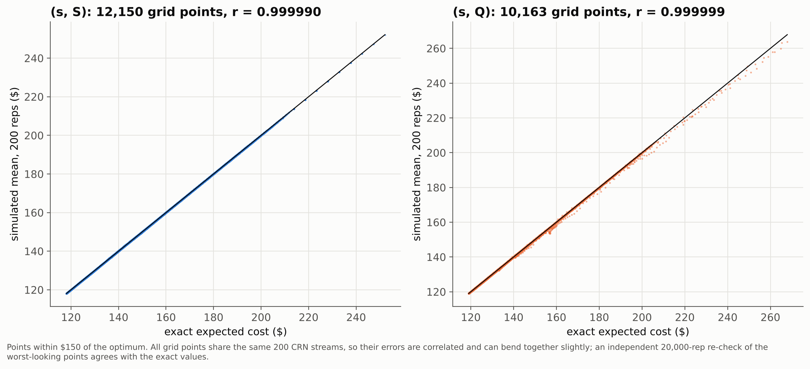

The grid points share one set of 200 CRN streams, so their simulation errors are correlated and can shift together slightly. That is visible for the most expensive (s, Q) points. Re-running the three worst-looking points with 20,000 independent replications each gave z = 1.5, 0.4 and 1.8 against the exact values.

## 5. Experimental design

| Stage | Purpose | Policies | Replications | Seed set |
|---|---|---|---|---|
| 1. Screening | map the cost surface | every integer s ∈ [0, 80] with S − s ∈ [1, 150] or Q ∈ [1, 150]; 12,150 points per policy | 200 per point, CRN across all points | 1 |
| 2. Re-evaluation | remove selection bias, rank the leaders | the 20 best stage-1 points per policy | 5,000 per point, CRN | 2 |
| 3. Final comparison | best (s, S) vs best (s, Q) | 2 (+ the (20, 40) baseline) | 10,000, CRN | 3 |
| CRN check | the same comparison without CRN | best (s, Q) | 10,000 | 4 |
| Sensitivity | re-optimize under 14 cost scenarios | grid s ∈ [−20, 100], S − s and Q ∈ [2, 200], step 2 | 100 (screen) + 2,000 (top 10) | 10–65 |

**Why three stages on independent random numbers?** The minimum of 12,150 noisy estimates is biased low, because the point that looks best is partly the one that got lucky (the *optimizer's curse*). Stage 2 re-estimates the leaders with fresh replications, so the reported costs are unbiased. Stage 3 uses yet another set of numbers for the head-to-head test. Within each stage CRN is used, so that differences between policies are estimated precisely.

**Selecting the best in stage 2.** We picked the candidate with the lowest stage-2 mean. We compared every other candidate with it using a paired-t test with a Bonferroni correction over the 19 comparisons (familywise α = 0.05). Candidates whose difference CI lies entirely above zero are called *significantly worse*.

## 6. Results (replications and comparison: Mary Reethika Reddy Kolukula; parameter search: Praneeth Kapila)

### 6.1 Cost surfaces

Both policies have a single, smooth valley (Figure 3). The best points of the two policies use the same reorder point, s = 24. Below Q = 25, the (s, Q) surface rises sharply because those rules cannot keep up with demand.

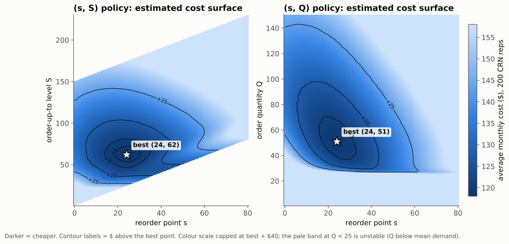

The bottom of each valley is flat (Figure 4). With s = 24, any S from 54 to 71 is within $1 of the best (s, S) cost, and any Q from 43 to 62 is within $1 of the best (s, Q) cost. The recommendation is therefore robust: rounding S to a convenient pallet size costs very little.

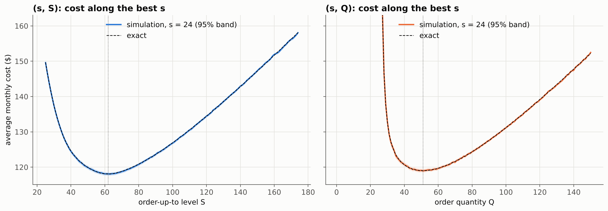

### 6.2 Selection

Top stage-2 candidates (cost in $/month; "exact" is from Section 4.2, used for auditing only):

| (s, S) | stage 1 | stage 2 ± CI | exact | worse than best? |
|---|---|---|---|---|
| **(24, 62)** | 118.09 | **118.13 ± 0.09** | 118.08 | — |
| (25, 61) | 118.05 | 118.14 ± 0.09 | 118.08 | no |
| (25, 63) | 118.10 | 118.14 ± 0.09 | 118.09 | yes |
| (25, 62) | 118.08 | 118.15 ± 0.09 | 118.08 | no |
| (24, 63) | 118.04 | 118.15 ± 0.09 | 118.10 | no |

| (s, Q) | stage 1 | stage 2 ± CI | exact | worse than best? |
|---|---|---|---|---|
| **(24, 51)** | 118.96 | **119.06 ± 0.10** | 119.00 | — |
| (25, 51) | 119.03 | 119.09 ± 0.09 | 119.03 | no |
| (25, 49) | 118.97 | 119.09 ± 0.10 | 119.03 | no |
| (24, 50) | 119.07 | 119.09 ± 0.10 | 119.01 | no |
| (24, 52) | 119.03 | 119.09 ± 0.10 | 119.01 | no |

Six (s, S) candidates and ten (s, Q) candidates are statistically tied with their best. Significance depends on how much the paired difference varies, not only on the mean. That is why (25, 63) is flagged while some candidates with slightly higher means are not: (25, 63) behaves almost identically to the best rule replication by replication, so even its tiny extra cost is detectable. The flat valley bottom means the cost cannot separate them at this precision. The stage-1 minimum (screening estimate 118.04) was indeed optimistic: the fresh estimate of the same point is 118.15. Checked against the exact costs, our chosen (s, S) = (24, 62) is **$0.002** from the true optimum (25, 62), and our chosen (s, Q) = (24, 51) **is** the true optimum.

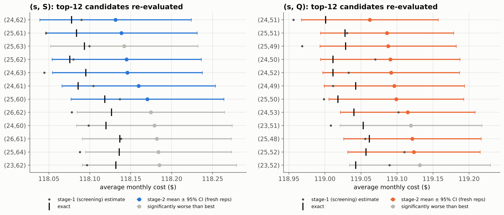

### 6.3 Final comparison

With 10,000 new CRN replications:

| Policy | Mean | 95% CI half-width | Ordering | Holding | Shortage |
|---|---|---|---|---|---|
| (s, S) = (24, 62) | 118.13 | 0.07 | 89.42 | 19.96 | 8.75 |
| (s, Q) = (24, 51) | 119.05 | 0.07 | 89.66 | 20.72 | 8.67 |
| (s, S) = (20, 40), baseline | 124.84 | 0.08 | 98.58 | 9.39 | 16.88 |

**Paired difference, (s, Q) − (s, S): $0.92, with 95% CI [$0.90, $0.95], t = 62.3, p < 10⁻³⁰⁰.** The (s, S) rule is better with overwhelming statistical confidence, but the margin is small: 0.78% of the monthly cost. Both optimized rules have nearly the same cost mix (Figure 6). Compared with the textbook rule, they order larger batches less often, saving $9.16 a month in ordering cost, and carry a bigger buffer. The buffer adds $10.57 in holding cost but saves $8.13 in shortage cost.

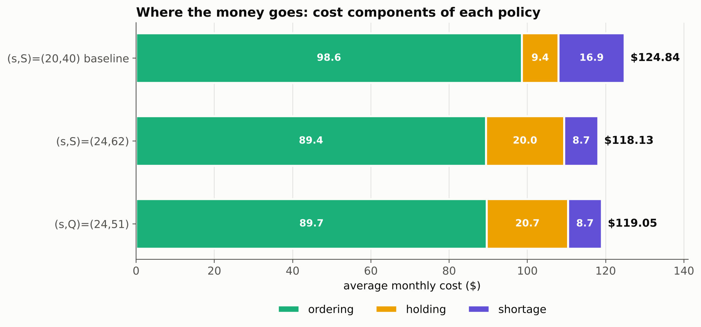

**Why (s, S) wins.** (s, S) always brings stock back to the same level. (s, Q) adds a fixed 51 to whatever is left, so after a heavy month it can remain short, and after a quiet month it overshoots and pays to store the surplus (Figure 1, near month 65). With a fixed setup cost, the (s, S) form is known to be optimal for this kind of problem (Scarf, 1960). Our results agree with that theory.

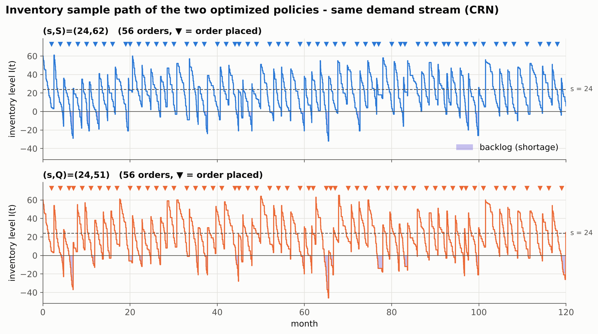

### 6.4 Value of common random numbers

Both policies' costs rise and fall with the same demand, so with CRN their difference varies much less (Figure 7). The variance of the paired difference is **9.7%** of what it would be with independent streams. The CI half-width is ±0.029 instead of ±0.093. Matching the CRN precision with independent sampling would take about **102,000 replications instead of 10,000**, roughly 10 times the work.

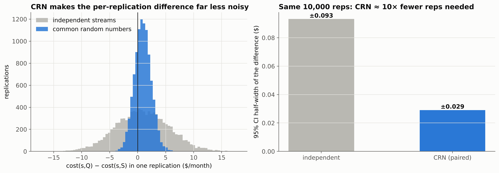

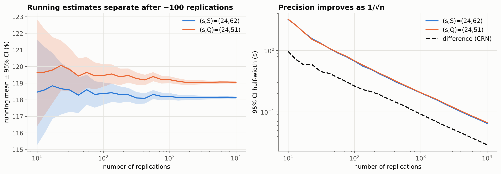

## 7. Sensitivity analysis

We re-optimized both policies from scratch, with screening followed by fresh re-evaluation, while changing one cost parameter at a time: K ∈ {8, 16, 32, 64, 128}, π ∈ {1, 2, 5, 10, 20} and h ∈ {0.5, 1, 2, 4}.

* **(s, S) is cheaper in all 14 scenarios**, by $0.42 to $5.76 per month.
* The gap is largest when holding is expensive (h = $4: $5.76) or setup is cheap (K = $8: $3.19). In both cases orders are small and frequent, and controlling the exact post-order level matters most.
* The optimal parameters move as theory predicts (Figure 11). A higher setup cost gives larger orders (S − s and Q grow) and a lower reorder point. A higher shortage cost raises s. A higher holding cost shrinks everything. At π = $1, backlogs are so cheap that the best (s, Q) rule reorders only once the stock is already 2 units in backlog (s = −2).

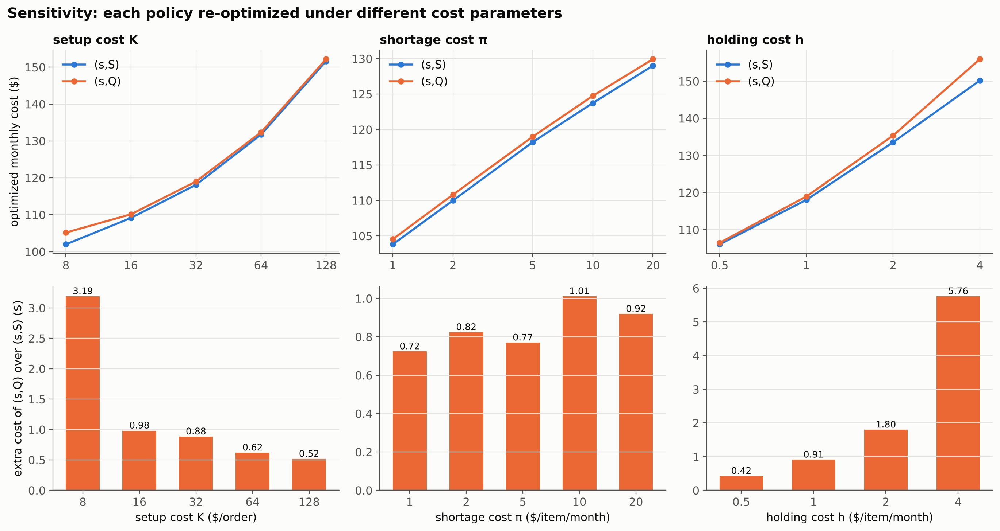

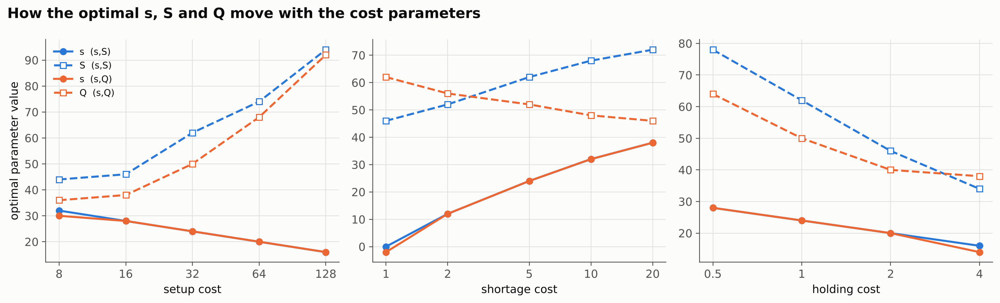

## 8. Conclusions and recommendation

1. **Adopt (s, S) = (24, 62).** It has the lowest average monthly cost of all 24,300 rules tested: $118.13 ± 0.07.
2. The choice is **robust**: S anywhere from 54 to 71 stays within $1 of the optimum.
3. If operations require fixed batch sizes, **(s, Q) = (24, 51)** costs only $0.92 (0.8%) more per month.
4. Simulation-based optimization worked well here. With CRN, a screening stage, and fresh re-evaluation, it found the true optimum, as confirmed by the exact calculation, without needing that calculation.

**Limitations.**

* Demand is stationary and only one product is modeled.
* There are no capacity or budget limits.
* The cost values are the textbook's.
* We used a fixed 120-month horizon starting from 60 units, so the short warm-up is included in the averages.

The pipeline re-runs the whole study for new inputs in about 4 minutes. The exact Markov-chain check depends on the delivery lag being shorter than the review period; with longer lags only the simulation would apply.

## 9. Team contributions

* **Jahnavi Gouru:** the simulation model (`model.py`): event logic, random-number streams, verification tests.
* **Mary Reethika Reddy Kolukula:** replications and policy comparison (`experiment.py`): confidence intervals, paired-t tests, the CRN analysis, validation.
* **Praneeth Kapila:** the parameter search (`optimize.py`): grid screening, re-evaluation and selection, sensitivity analysis.

All three wrote the report and presentation sections for their part.

## References

1. A. M. Law, *Simulation Modeling and Analysis*, 5th ed., McGraw-Hill, 2015, Section 1.5 (inventory system).
2. H. Scarf, "The optimality of (S, s) policies in the dynamic inventory problem," in *Mathematical Methods in the Social Sciences*, Stanford University Press, 1960.
3. B. L. Nelson, *Foundations and Methods of Stochastic Simulation*, 2nd ed., Springer, 2021: common random numbers, ranking and selection.
4. J. Banks, J. S. Carson, B. L. Nelson, D. M. Nicol, *Discrete-Event System Simulation*, 5th ed., Pearson, 2010.

## Appendix: reproducing the results

```bash
pip install -r requirements.txt
python -m pytest -q                  # 15 tests
python experiments/run_all.py        # all experiments, about 4 minutes
python experiments/make_figures.py   # figures in results/figures/
python experiments/key_numbers.py    # results/key_numbers.json
cd presentation && npm install && node build_deck.js   # slide deck
```
